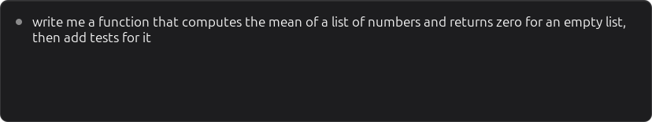

<p align="center">
  
</p>

<h1 align="center">voiceflow</h1>

<p align="center">
  <b>Press a hotkey. Speak. Your words appear in whatever window has focus.</b>
</p>

<p align="center">
  Free, open-source, local voice dictation: a Wispr Flow / Superwhisper alternative that also works on
  <b>GNOME on Wayland</b>. Whisper runs on your own GPU. No cloud, no subscription, no audio leaving your machine.
</p>

<p align="center">
  Linux (GNOME/Wayland) · Windows 10/11 · macOS (Apple Silicon, alpha) · Android &amp; iOS keyboards (early alpha, build from source)
</p>

<p align="center">
  <a href="https://github.com/AveJaPl/voiceflow/actions/workflows/ci.yml"></a>
  <a href="LICENSE"></a>
  <a href="https://github.com/AveJaPl/voiceflow/releases/latest"></a>
  <a href="#download--install"></a>
  <a href="https://github.com/AveJaPl/voiceflow/stargazers"></a>
</p>

<p align="center">
  <a href="#download--install">Download</a> ·
  <a href="https://voiceflow.pbdevs.com/en/">Website</a> ·
  <a href="#faq">FAQ</a> ·
  <a href="CONTRIBUTING.md">Contributing</a> ·
  <a href="https://voiceflow.pbdevs.com/pl/">Polski</a>
</p>

<!-- DEMO: replace docs/assets/demo.gif (10-15 s: hotkey -> live preview overlay -> text pasted into a Wayland window). Keep under 10 MB.
     When the recording exists, change the src below to docs/assets/demo.gif (or to a GitHub user-attachments link). See CONTRIBUTING.md. -->
<p align="center">
  
</p>

<p align="center"><i>The on-screen preview while you speak: it updates every second and never steals focus.
Release the hotkey and the final, full-context transcription is pasted where your cursor is.</i></p>

## How it works

1. **Press the hotkey** (Linux: your GNOME shortcut, `Super+G` by default; Windows: `Ctrl+Shift+Space`; macOS: hold-to-talk).
2. **Speak.** A live preview updates about every second and never steals focus.
3. **Release.** The full-context transcription runs on your GPU (with an automatic CPU fallback).
4. **The text is pasted** into whatever window has focus, and your previous clipboard is restored.

## Download / Install

| Platform | Status | Get it |
|---|---|---|
| Linux (Ubuntu, GNOME on Wayland) | stable | [one-line installer](#linux) |
| Windows 10/11 | beta | `voiceflow-install.bat` from the [latest release](https://github.com/AveJaPl/voiceflow/releases/latest) |
| macOS 26 (Apple Silicon) | alpha | [`VoiceFlow-mac.dmg`](https://github.com/AveJaPl/voiceflow/releases/tag/mac-v0.8.0) (signed & notarized) |
| Android | early alpha | build from source: [android/README.md](android/README.md) |
| iOS | alpha | build from source: [ios/README.md](ios/README.md) |

The commands below are **not** interchangeable between systems.

### Linux

```bash
curl -fsSL https://raw.githubusercontent.com/AveJaPl/voiceflow/main/install.sh | bash
```

Then press `Super+G`, speak, press it again. **To update, run the same command again.**

<details>
<summary>What the installer does, reading it first, manual install</summary>

The only step that asks for sudo installs `ydotool` + a udev rule (the script
explains why). The speech model (~1.6 GB) is downloaded **with a visible
progress bar as the final step**, so once it says done, everything works.

Prefer to read before you run? `curl -fsSL …/install.sh > install.sh`, open it,
then `bash install.sh`.

Manual install from source:

```bash
git clone https://github.com/AveJaPl/voiceflow && cd voiceflow
sudo bash scripts/install-system-deps.sh   # ydotool, wl-clipboard, python3-gi-cairo, udev
uv sync                                    # pinned Python 3.13 + dependencies
mkdir -p ~/.local/bin
printf '#!/usr/bin/env bash\nexec "%s/.venv/bin/voiceflow" "$@"\n' "$PWD" > ~/.local/bin/voiceflow
chmod +x ~/.local/bin/voiceflow
systemctl --user enable --now ydotool.service
cp systemd/voiceflow.service ~/.config/systemd/user/
systemctl --user daemon-reload && systemctl --user enable --now voiceflow.service
bash scripts/install-hotkey.sh             # Super+G by default
```
</details>

### Windows 10 / 11

Download **`voiceflow-install.bat`** from the
[latest release](https://github.com/AveJaPl/voiceflow/releases/latest) (Assets) and double-click it.
Or, from PowerShell or cmd:

```
powershell -NoProfile -ExecutionPolicy Bypass -Command "irm https://raw.githubusercontent.com/AveJaPl/voiceflow/main/windows/install.ps1 | iex"
```

Then press `Ctrl+Shift+Space`, speak, press it again.

<details>
<summary>SmartScreen, updating, WSL warning</summary>

- The `.bat` is not signed, so SmartScreen may warn: choose *More info → Run anyway*.
- **To update, run the same file or command again.** The installer downloads the
  speech model (~1.6 GB) with a progress bar as its final step.
- A signed `.exe` installer is planned and will appear on the
  [Releases](https://github.com/AveJaPl/voiceflow/releases) page when ready.
- Do **not** run the Linux command on Windows: if WSL is installed, `| bash`
  silently executes it inside WSL, where dictation cannot work (the installer
  detects this and stops).

Details and current limitations: [docs/WINDOWS.md](docs/WINDOWS.md).
</details>

### macOS

Download [`VoiceFlow-mac.dmg`](https://github.com/AveJaPl/voiceflow/releases/tag/mac-v0.8.0)
(signed and notarized by Apple), open it and drag VoiceFlow to Applications. The first launch asks
for Microphone and Accessibility permissions and downloads a model. Requires **macOS 26** on
**Apple Silicon**. The app lives in the menu bar; dictation is hold-to-talk.

<details>
<summary>Build from source</summary>

Full walkthrough in [macos/README.md](macos/README.md); the short version:

```bash
brew install --cask xcodes        # or install Xcode from the App Store
brew install whisper-cpp xcodegen
git clone https://github.com/AveJaPl/voiceflow.git
cd voiceflow/macos
xcodegen generate
open VoiceFlow.xcodeproj          # pick your team under Signing, then Cmd+R
```

The project targets **macOS 26**. The signing team in `project.yml` belongs to
whoever set the port up, so substitute your own, and the Homebrew paths assume
Apple Silicon. Both are covered in [macos/README.md](macos/README.md).
</details>

## Why voiceflow?

- **Private.** Audio and text never leave your machine. The optional once-a-day update check can be turned off with `updates.check: false`.
- **GPU-fast.** faster-whisper `large-v3-turbo` on CUDA, kept warm in VRAM by a background daemon, with an automatic CPU (`int8`) fallback. The CUDA libraries come from pip: no CUDA Toolkit install.
- **Wayland-native.** Works on GNOME on Wayland, where the paid dictation apps don't ship.
- **Free.** MIT licensed, no account, no subscription.

## Features

- **Live preview + final pass.** A small always-on-top card shows what the model hears while you talk; the pasted text is a second, full-context pass, so accuracy is never traded for the preview.
- **Paste that respects your clipboard.** Text goes in through the clipboard and a real paste keystroke (`wl-copy` + `ydotool` on Wayland, Win32 clipboard + `SendInput` on Windows, Accessibility on macOS); your previous clipboard is put back.
- **Voice-chat aware.** Discord's mic stream is muted and other apps' audio is ducked while you dictate, with per-app rules (PipeWire on Linux, Core Audio on Windows).
- **Custom vocabulary.** Product names and jargon are pushed into the decoder (`model.vocabulary`). It biases recognition only; it never rewrites your words.
- **Any language.** Any language Whisper speaks, or automatic detection (`model.language`).
- **Desktop app.** GTK4/libadwaita on Linux, Qt on Windows: dictation history, stats (words per day, streak, activity calendar) and a vocabulary editor.
- **GNOME top-bar indicator** with your dictation stats.
- **Shared dictation rooms.** A talk lock while someone else is speaking, ducking for everyone and a session leaderboard. Only events and counts are sent, never audio or text; rooms on your LAN are discovered via mDNS. See [rooms/README.md](rooms/README.md).
- **Self-hosted HTTP API.** `pip install "voiceflow[server]"` or the [Dockerfile](Dockerfile): `POST /api/v1/transcribe`, Bearer token required. See [Server mode](#server-mode-http-api).
- **Optional Discord Rich Presence** while dictating.
- **Mobile keyboards (alpha).** An Android IME with on-device whisper.cpp ([android/](android/README.md)) and an iOS keyboard extension ([ios/](ios/README.md)).
- **Tested without hardware.** 500+ tests that need no GPU, microphone or display run in CI on every commit.

## How is it different?

As of November 2026, from each project's own site. Corrections welcome.

| | voiceflow | [Wispr Flow](https://wisprflow.ai) | [Superwhisper](https://superwhisper.com) | [Handy](https://github.com/cjpais/Handy) | [nerd-dictation](https://github.com/ideasman42/nerd-dictation) |
|---|---|---|---|---|---|
| Price | free | free tier with weekly limits; Pro $15/mo | free tier (local models); Pro $8.49/mo | free | free |
| Runs locally | yes | no (cloud transcription) | yes (local models) | yes | yes |
| Linux / Wayland | yes, GNOME on Wayland | no Linux app | no Linux app | yes, limited Wayland support | yes (with ydotool / dotool / wtype) |
| GPU acceleration | CUDA | n/a (cloud) | ? | yes (Whisper models) | ? |
| Open source | MIT | no | no | MIT | GPL-3.0 |
| Platforms | Linux, Windows, macOS; Android & iOS alpha | Mac, Windows, iPhone, Android | Mac, Windows, iPhone, Android | Linux, Windows, macOS | Linux |

Where others are ahead, honestly: **Handy** ships ready-made packages (`.deb`, AppImage, Homebrew cask,
winget, Nix) and is the more mature cross-platform app; voiceflow has no `.deb`/AUR/Flatpak yet
([#4](https://github.com/AveJaPl/voiceflow/issues/4)). **Wispr Flow** and **Superwhisper** have polished
commercial apps on more devices.

**Related projects:** [Handy](https://github.com/cjpais/Handy) ·
[hyprwhspr](https://github.com/goodroot/hyprwhspr) ·
[nerd-dictation](https://github.com/ideasman42/nerd-dictation) ·
[Speech Note](https://github.com/mkiol/dsnote)

## Privacy

Transcription runs locally on your machine. By default the only network connection is a
once-a-day check for new releases on GitHub, which `updates.check: false` turns off (the model
itself is downloaded once at install time). Shared rooms and Discord Rich Presence are opt-in and
never send audio or text. The `curl | bash` installer is a plain script you can
[read first](install.sh).

## Requirements

| | |
|---|---|
| OS | Linux with **PipeWire** (developed on Ubuntu 26.04) · **Windows 10/11** ([docs/WINDOWS.md](docs/WINDOWS.md)) · **macOS 26** on Apple Silicon ([macos/README.md](macos/README.md)) |
| Desktop | **GNOME on Wayland** (developed on GNOME 50) · **KDE / Hyprland / Sway**: experimental, the hotkey installer speaks all four ([#1](https://github.com/AveJaPl/voiceflow/issues/1)) |
| Python | 3.13 (installed for you by `uv`) |
| System packages | `ydotool`, `wl-clipboard`, `python3-gi-cairo` (the last one enables charts in the GTK application) |
| GPU | optional; NVIDIA with ~2.5 GB free VRAM for `large-v3-turbo` (CUDA libraries come from pip, **no CUDA Toolkit install needed**) |
| Disk | ~1.6 GB model + ~2.7 GB environment |

## Usage

| | |
|---|---|
| dictate | `Super+G` → speak → `Super+G` |
| cancel without pasting | `voiceflow cancel` |
| health check & diagnostics | `voiceflow status` |
| logs | `journalctl --user -u voiceflow -f` |
| change the hotkey | `VOICEFLOW_BINDING='<Control><Alt>space' bash scripts/install-hotkey.sh` |
| free the VRAM (before gaming) | `systemctl --user stop voiceflow` |
| stress-test / leak check | `bash scripts/audit.sh` |

## Configuration

`~/.config/voiceflow/config.yaml`, created with commented defaults on first run;
restart the daemon after editing.

```yaml
model:
  name: large-v3-turbo    # any faster-whisper model
  device: cuda            # cuda | cpu | auto
  language: pl            # ISO 639-1; null = auto-detect
  vocabulary: []          # names the decoder should lean towards
inject:
  method: clipboard       # clipboard | ydotool | auto
  paste_key: ctrl+shift+v # Linux terminals paste with shift; Windows uses ctrl+v
mute_apps:
  apps: [WEBRTC VoiceEngine]   # Discord's mic stream (Windows: Discord.exe)
  duck_to: 0.6            # leave 60% of each app's current volume
```

<details>
<summary>Full configuration reference</summary>

| key | default | meaning |
|---|---|---|
| `model.name` | `large-v3-turbo` | any faster-whisper model id |
| `model.device` | `cuda` | `cuda` / `cpu` / `auto`; CUDA failure falls back to CPU |
| `model.compute_type` | `float16` | precision on GPU; CPU uses `int8` |
| `model.language` | `pl` | ISO 639-1 code or `null` for auto-detect |
| `model.beam_size` | `5` | decoder beam width |
| `model.vocabulary` | `[]` | terms biased into decoding |
| `audio.source` | `null` | PipeWire source; `null` = default mic |
| `audio.max_seconds` | `300` | safety cap on one recording |
| `inject.method` | `clipboard` | `ydotool` types ASCII only; `clipboard` is safe for all languages |
| `inject.paste_key` | `ctrl+shift+v` (Linux), `ctrl+v` (Windows) | the paste chord that gets sent |
| `inject.restore_clipboard` | `true` | put the previous clipboard back |
| `preview.enabled` | `true` | live preview while speaking |
| `preview.interval_seconds` | `1.0` | preview refresh rate |
| `mute_apps.enabled` | `true` | mute configured apps' mic streams while recording |
| `mute_apps.apps` | `[WEBRTC VoiceEngine]`, Windows `[Discord.exe]` | apps whose mic is muted: PipeWire `application.name` on Linux, executable name on Windows |
| `mute_apps.duck_enabled` | `true` | also duck those apps' playback |
| `mute_apps.duck_to` | `0.6` | multiplier applied to each app's current volume |
| `mute_apps.duck_rules` | `{}` | per-application playback targets keyed by PipeWire `application.name` |
| `presence.enabled` | `false` | show Discord Rich Presence while dictating |
| `presence.client_id` | `""` | Discord developer application ID used for Rich Presence |
| `overlay.enabled` | `true` | the on-screen indicator card |
| `tray.enabled` | `true` | the top-bar dictation-stats indicator |
| `updates.check` | `true` | once-a-day check for a new release on GitHub |

The config file is generated once and not migrated: delete it to regenerate with
current defaults.
</details>

## Server mode (HTTP API)

The same recognizer can run as a small HTTP service (for a web app, a tablet,
or any machine without a GPU) so audio never leaves your own infrastructure:

```bash
pip install "voiceflow[server]"        # or: docker build -t voiceflow-api .
VOICEFLOW_API_TOKEN=$(openssl rand -hex 32) voiceflow serve --port 8000
```

- `POST /api/v1/transcribe`: `multipart/form-data` with an `audio` field
  (webm/opus, ogg, m4a, wav…), header `Authorization: Bearer <token>`.
  Returns `{"text", "language", "audio_seconds", "transcription_seconds"}`.
- `GET /api/health`: liveness only. `GET /api/v1/model`: model details (token).
- Configured entirely through environment variables: `VOICEFLOW_MODEL`
  (default `large-v3-turbo`), `VOICEFLOW_DEVICE` (`cpu`), `VOICEFLOW_COMPUTE_TYPE`
  (`int8`), `VOICEFLOW_LANGUAGE` (`pl`), `VOICEFLOW_CPU_THREADS`,
  `VOICEFLOW_VOCABULARY` (comma-separated), `VOICEFLOW_ROOT_PATH` (`/api`).
- The token is mandatory: the server refuses to start without one, and requests
  without it are rejected before the body is read. Put the model cache on a
  volume (`HF_HOME=/models`) so redeploys do not download it again.

## Architecture

```
hotkey ─▶ voiceflow toggle ──unix socket──▶ voiceflow daemon (systemd --user)
                                             ├─ recorder     pw-record, 16 kHz WAV
                                             ├─ transcriber  faster-whisper, warm in VRAM
                                             ├─ preview      re-transcribes the tail every 1 s
                                             ├─ overlay      separate GTK3 process (X11 popup)
                                             ├─ tray         top-bar indicator (AppIndicator3)
                                             ├─ micmute      mutes/ducks voice chats (wpctl)
                                             └─ injector     wl-copy + paste keystroke
```

A thin client (~0.1 s startup) talks to a persistent daemon, so the model loads once
per login, not once per dictation. The modules do not import each other (the daemon
composes them), which is what keeps the test suite hardware-free and the platform
ports tractable.

<details>
<summary>Why GNOME/Wayland needed all this (field notes)</summary>

Constraints discovered the hard way. Read this before porting:

- **You cannot type into another window.** Wayland forbids input injection and GNOME
  implements no `virtual-keyboard` protocol, so `wtype` is out. `ydotool` works at the
  kernel level via `/dev/uinput`, but its `type` command silently drops non-ASCII
  characters. Hence: clipboard + a real paste keystroke, clipboard restored after.
- **A window cannot refuse focus**, so a normal preview window would swallow the paste.
  The overlay is an X11 override-redirect popup via XWayland: the one window type the
  compositor neither focuses nor repositions.
- **`pw-record` exits 1 after SIGINT** even when the WAV is complete. Success must be
  judged by parsing the WAV header, not the exit code.
- **`wl-copy` forks**, and its child owns the Wayland selection; piping its stdio and
  waiting for EOF deadlocks every paste. No pipes to self-daemonizing processes.
- **User services race the login.** From `default.target` the daemon gets no
  `DISPLAY`/`XAUTHORITY`; the unit binds to `graphical-session.target`, with a runtime
  fallback that locates Mutter's XWayland auth cookie.
</details>

## FAQ

**Does it send anything to the cloud?**
No audio and no text. The only default network call is the once-a-day update check, which
`updates.check: false` disables. Rooms and Discord Rich Presence are off until you turn them on.

**Do I need an NVIDIA GPU?**
No. Without CUDA, voiceflow falls back to the CPU with `int8` automatically. It is slower, and just as private.

**Which Linux desktops work?**
It is developed and tested on GNOME on Wayland. KDE, Hyprland, Sway and X11 are untested;
please tell us how it goes with a [platform report](https://github.com/AveJaPl/voiceflow/issues/new?template=platform_report.yml).

**Which languages?**
Any language Whisper supports, or automatic detection. Set `model.language` to your language code
(`en`, `de`, …) or to `null` to auto-detect.

**Is the UI in English?**
Not yet, see [Known limitations](#known-limitations).

## Known limitations

- **The UI is currently in Polish** (the author dictates in Polish). Translating it is
  [#5](https://github.com/AveJaPl/voiceflow/issues/5), and help is welcome.
- **The default `model.language` is `pl`.** Set it to your language, or to `null` for automatic detection.
- **Windows:** the `.bat` installer is unsigned, so SmartScreen shows a warning.
- **macOS** is an alpha; **Android and iOS** are build-from-source only.
- **Linux:** no `.deb`, AUR or Flatpak package yet ([#4](https://github.com/AveJaPl/voiceflow/issues/4)).

## Roadmap

- [x] **Native desktop app** (GTK4/libadwaita on Linux, Qt on Windows): history, stats,
  vocabulary editor and settings without touching YAML
- [x] **Windows 10/11**: same core, Win32 backends (in-daemon global hotkey,
  PortAudio recording, clipboard + `SendInput` injection, no-focus overlay,
  Core Audio ducking, CUDA transcription, toasts). See [docs/WINDOWS.md](docs/WINDOWS.md);
  feedback in [#2](https://github.com/AveJaPl/voiceflow/issues/2)
- [x] **macOS** *(alpha)*: a native SwiftUI menu-bar app with hold-to-talk, on-device
  whisper.cpp, a non-activating overlay and Accessibility injection; signed DMG on the
  [releases page](https://github.com/AveJaPl/voiceflow/releases/tag/mac-v0.8.0)
  ([#3](https://github.com/AveJaPl/voiceflow/issues/3))
- [ ] **Packaging**: `.deb`/AppImage, AUR, winget, Homebrew cask
  ([#4](https://github.com/AveJaPl/voiceflow/issues/4))
- [ ] **English UI** (i18n of user-facing strings) ([#5](https://github.com/AveJaPl/voiceflow/issues/5))
- [ ] **Signed Windows installer** (`.exe`)
- [ ] **Other Wayland compositors** (KDE, Hyprland, Sway): experimental, needs testers
  ([#1](https://github.com/AveJaPl/voiceflow/issues/1))
- [ ] **Android** keyboard (IME) with on-device whisper.cpp, early alpha in [`android/`](android/README.md)
  ([#6](https://github.com/AveJaPl/voiceflow/issues/6))
- [ ] **iOS** keyboard extension, in progress in [`ios/`](ios/README.md)
  ([#7](https://github.com/AveJaPl/voiceflow/issues/7))

Each item has a tracking issue with implementation notes: grab one, comment, and go.

## Contributing

PRs, bug reports and reports from new desktops or GPUs are all welcome. The test suite runs
without a GPU, microphone or display (`uv run pytest`), so you can contribute from any machine.
Start with [CONTRIBUTING.md](CONTRIBUTING.md) and the
[good first issues](https://github.com/AveJaPl/voiceflow/labels/good%20first%20issue).

## License

[MIT](LICENSE) © Filip Piątek
